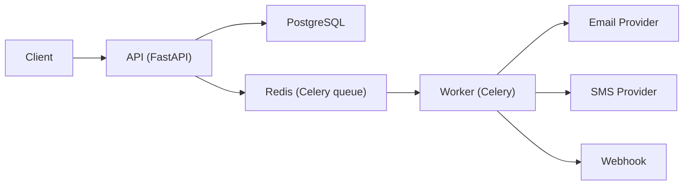

[](https://github.com/your-org/notification-service/actions/workflows/ci.yml)
[](LICENSE)
[](docker-compose.yml)

# Notification Service

Open-source, self-hostable notification infrastructure — send email, SMS, and webhooks through a single REST API with a React dashboard and multi-workspace support.

## Architecture



## Quickstart

```bash
git clone https://github.com/your-org/notification-service.git
cd notification-service
```

```bash
python scripts/generate_env.py
```

```bash
docker compose up -d
```

Visit [http://localhost](http://localhost) to open the dashboard.

For deploying to production with automatic TLS, domain routing, and hardened secrets, see the [Production with HTTPS Guide](docs/self-hosting.md#production-with-https).

## Features

- Multi-channel delivery: email (SMTP, Brevo), SMS (Twilio), webhooks
- Per-workspace provider credentials — bring your own keys
- Template engine with variable substitution
- Bulk send up to 200 recipients per request
- Scheduled notifications (up to 30 days ahead)
- Suppression list (opt-out, bounce)
- JWT-based user auth with workspace roles (member, admin, superadmin)
- Rate limiting backed by Redis
- Celery beat scheduler (optional)
- React dashboard with live status updates

## Configuration

| Env Var | Default | Description |
|---|---|---|
| `APP_NAME` | `Notification Service` | Application name shown in the UI |
| `DEBUG` | `false` | Enable debug mode |
| `DATABASE_URL` | — | PostgreSQL connection string (required) |
| `REDIS_URL` | `redis://localhost:6379` | Redis URL; used for Celery broker and backend |
| `DB_POOL_SIZE` | `5` | SQLAlchemy connection pool size |
| `DB_MAX_OVERFLOW` | `5` | Max connections above pool size |
| `DB_POOL_TIMEOUT` | `30` | Seconds to wait for a connection |
| `DB_POOL_RECYCLE` | `1800` | Recycle connections after this many seconds |
| `CELERY_QUEUE` | `notification_service_queue` | Celery queue name |
| `PUBLIC_BASE_URL` | `http://localhost:8001` | Public-facing API base URL (used in webhook callbacks) |
| `WEBHOOK_SECRET` | — | HMAC secret for signing outgoing webhook payloads |
| `WEBHOOK_VERIFY` | `true` | Verify TLS certs when delivering webhooks |
| `EMAIL_PROVIDER_ORDER` | `brevo,smtp` | Comma-separated provider preference order |
| `SMTP_HOST` | — | SMTP server hostname |
| `SMTP_USER` | — | SMTP authentication username |
| `SMTP_PASSWORD` | — | SMTP authentication password |
| `SMTP_FROM_EMAIL` | — | Default sender address for SMTP |
| `SMTP_PORT` | `587` | SMTP port |
| `SMTP_USE_TLS` | `true` | Enable STARTTLS |
| `BREVO_API_KEY` | — | Brevo (Sendinblue) API key |
| `BREVO_FROM_EMAIL` | — | Default sender address for Brevo |
| `TWILIO_ACCOUNT_SID` | — | Twilio account SID |
| `TWILIO_AUTH_TOKEN` | — | Twilio auth token |
| `TWILIO_FROM_NUMBER` | — | Twilio sender phone number |
| `API_KEY` | — | Master API key for the default workspace (required) |
| `JWT_SECRET` | — | Secret for signing JWT tokens (required) |
| `JWT_EXPIRE_MINUTES` | `480` | JWT token lifetime in minutes |
| `METRICS_TOKEN` | — | Bearer token for the `/metrics` endpoint |
| `LOG_FORMAT` | `text` | Log format: `text` or `json` |
| `FRONTEND_URL` | `http://localhost:5173` | Allowed CORS origins (comma-separated) |
| `SCHEDULE_MAX_DAYS` | `30` | Maximum days ahead a notification can be scheduled |
| `BULK_MAX_RECIPIENTS` | `200` | Maximum recipients per bulk send request |
| `MAX_WORKSPACES_PER_USER` | `5` | Maximum workspaces a single user can own |
| `UNSUBSCRIBE_SECRET` | — | HMAC secret for one-click unsubscribe links |
| `WEBHOOK_CHANNEL_ALLOWED_HOSTS` | `hooks.slack.com,discord.com,discordapp.com` | Allowed outbound webhook hosts |
| `SIGNUP_MODE` | `open` | Registration mode: `open`, `invite_only`, or `closed` |
| `REQUIRE_EMAIL_VERIFICATION` | `true` | Require email verification on signup |
| `SYSTEM_MAIL_BACKEND` | `provider` | System mail backend: `provider` or `console` |
| `FRONTEND_PUBLIC_URL` | `http://localhost:5173` | Public frontend URL (used in system emails) |
| `ENCRYPTION_KEY` | — | Fernet key(s) for encrypting provider credentials |
| `ALLOW_PRIVATE_SMTP_HOSTS` | `false` | Allow SMTP relay to private/internal hostnames |
| `TRUSTED_PROXY_COUNT` | `0` | Number of trusted reverse proxies (for real IP detection) |
| `RATE_LIMIT_STORAGE_URI` | — | Redis URI for rate limit counters (defaults to REDIS_URL) |
| `QUOTA_ENABLED` | `true` | Enable per-workspace sending quotas |
| `TURNSTILE_SECRET_KEY` | — | Cloudflare Turnstile secret key |
| `TURNSTILE_SITE_KEY` | — | Cloudflare Turnstile site key |

## API Quick Reference

| Method | Path | Description |
|---|---|---|
| `GET` | `/health` | Service health check |
| `POST` | `/auth/register` | Register a new user |
| `POST` | `/auth/login` | Obtain a JWT token |
| `GET` | `/workspaces` | List workspaces for current user |
| `POST` | `/workspaces` | Create a new workspace |
| `POST` | `/notifications/email` | Queue an email notification |
| `POST` | `/notifications/sms` | Queue an SMS notification |
| `POST` | `/notifications/webhook` | Queue a webhook notification |
| `GET` | `/notifications` | List notifications |
| `GET` | `/notifications/{id}` | Get a single notification |
| `POST` | `/notifications/{id}/retry` | Retry a failed notification |
| `POST` | `/notifications/bulk` | Bulk send to multiple recipients |
| `GET` | `/templates` | List templates |
| `POST` | `/templates` | Create a template |
| `GET` | `/suppressions` | List suppression entries |
| `POST` | `/suppressions` | Add a suppression entry |
| `DELETE` | `/suppressions/{id}` | Remove a suppression entry |

## Development

### Backend

```bash
cd backend
python -m venv venv
source venv/bin/activate   # macOS/Linux
# venv\Scripts\activate    # Windows

pip install -r requirements.txt
cp .env.example .env       # edit with your values
alembic upgrade head

# Terminal 1 — API
uvicorn app.main:app --reload --port 8001

# Terminal 2 — Worker
celery -A app.celery_app worker --loglevel=info -Q notification_service_queue --pool=solo
```

### Frontend

```bash
cd frontend
npm ci
cp .env.example .env       # set VITE_API_BASE_URL=http://localhost:8001
npm run dev
```

## Contributing

See [CONTRIBUTING.md](CONTRIBUTING.md) for guidelines on setting up a development environment, running tests, and submitting pull requests.

## License

[MIT](LICENSE) — Copyright (c) 2025 Notification Service Contributors
